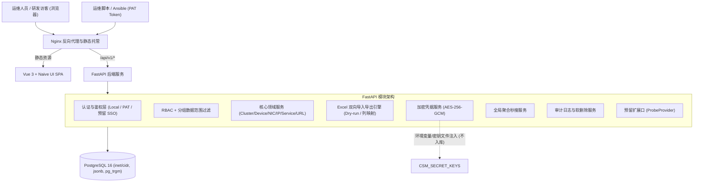
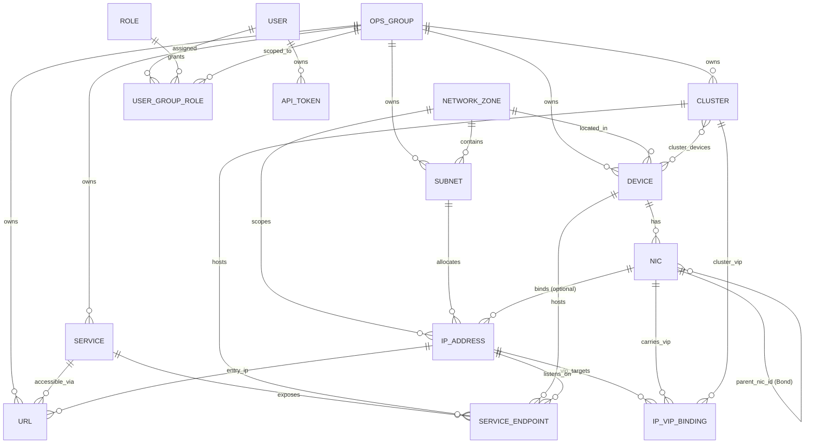

# Oh-My-CSM 系统设计规格文档

> **定位**：面向运维团队的轻量化资产与网络拓扑台账管理系统（CMDB-Lite）。以 **集群、设备、网卡、IP（网段）、服务、URL** 为核心实体，以 Web 系统为唯一事实源（Single Source of Truth），解决零散 Excel 表格整合难、跨表反查慢、多人协作缺权限与缺审计的核心痛点。

---

## 1. 设计目标与总体原则

### 1.1 核心能力范围（一期）
1. **六大关联资产与网络拓扑台账**：覆盖 **集群（Cluster）、设备（Device）、网卡（NIC）、IP / 网段（IPAM）、服务与端点（Service & Endpoint）、URL**，支持任意节点双向全链路反查。
2. **渐进式补全（Graceful Incompleteness）**：建立结构化主干关系，同时允许初期录入或迁移老 Excel 时存在局部缺失（如先录 URL + IP，后续补设备/网卡/集群），并在看板中提示待补全项。
3. **网卡与 IP 精准绑定 + IPAM 视图**：明确 **设备 → 网卡 → IP** 绑定模型（支持 Bond 聚合口与多 IP），兼容 VIP/漂移 IP 与未分配游离 IP；内置网段（CIDR）管理与 IP 格子矩阵可视化。
4. **Excel 双向批处理引擎**：支持 **标准多 Sheet 模板** 与 **老旧单 Sheet 宽表（前端列映射）** 两种导入模式；导入前必须经过 Dry-run 差异预览与冲突策略选择，支持按筛选结果一键导出。
5. **RBAC + 分组数据隔离 + 审计合规**：按角色 + 业务/运维分组控制操作与可见范围，提供独立加密凭据子模块（查看明文强审计）、个人 API Token（PAT）、全量字段级 Diff 审计日志与软删除回收站。
6. **可扩展预留**：底层预留 **状态探测插件接口（ProbeProvider）** 与 **企业 SSO 认证接口（AuthProvider: OIDC / LDAP）**，二期平滑接入无需重构核心表结构。

### 1.2 技术栈选型

| 层级 | 技术选型 | 说明 |
| --- | --- | --- |
| **后端框架** | Python 3.12 + FastAPI + Pydantic v2 | 异步高性能，自动生成 OpenAPI 文档 |
| **数据访问** | SQLAlchemy 2.0 (async) + `asyncpg` + Alembic | 异步 ORM + 严格迁移管理 |
| **Excel 处理** | `openpyxl` | 轻量、无重依赖，支持多 Sheet 读写与样式模板生成 |
| **前端框架** | Vue 3 + TypeScript + Vite | 组合式 API + 严格类型约束 |
| **UI 与样式** | Naive UI + UnoCSS + Pinia + Vue Router | 现代清爽的中后台组件库 + 轻量原子 CSS |
| **数据库** | PostgreSQL 16 | 原生 `inet`/`cidr`、`jsonb`、Partial Unique Index、`pg_trgm` 模糊索引 |
| **部署交付** | Docker Compose + Nginx + 离线镜像脚本 + `pg_dump` 备份脚本 | 支持完全内网离线一键部署 |

---

## 2. 系统架构与仓库规划

### 2.1 逻辑架构图



### 2.2 Monorepo 目录结构

```text
oh-my-csm/
├── docs/
│   └── DESIGN.md                  # 本设计文档
├── backend/
│   ├── alembic/                   # 数据库迁移脚本
│   ├── app/
│   │   ├── main.py                # FastAPI 入口、生命周期、全局异常处理
│   │   ├── core/                  # 配置、数据库引擎、加密、安全、AuthProvider 接口
│   │   ├── models/                # SQLAlchemy 2.0 实体模型
│   │   ├── schemas/               # Pydantic v2 请求/响应模型
│   │   ├── api/v1/                # 路由层（按领域分文件）
│   │   ├── services/              # 业务逻辑、数据隔离查询、审计、Excel 引擎、Probe 接口
│   │   └── cli.py                 # 管理命令（初始化超管、字典种子、凭据密钥轮换）
│   ├── tests/                     # Pytest 异步单元与集成测试
│   ├── pyproject.toml
│   └── Dockerfile
├── frontend/
│   ├── src/
│   │   ├── api/                   # Axios 封装与后端接口定义
│   │   ├── stores/                # Pinia 状态（auth、dict、app）
│   │   ├── router/                # 路由表与权限守卫
│   │   ├── layouts/               # Naive UI 主框架 + Ctrl/Cmd+K 全局搜索
│   │   ├── components/            # 公共组件（关联卡片、IP矩阵、凭据抽屉、导入向导、审计时间线）
│   │   └── views/                 # 业务页面
│   ├── package.json
│   └── Dockerfile
└── deploy/
    ├── docker-compose.yml         # 一键编排 (nginx + backend + postgres)
    ├── nginx.conf                 # 反代与前端 History 路由配置
    ├── .env.example               # 环境变量模板
    └── scripts/
        ├── export-offline.sh      # 有网环境构建并导出离线镜像 tar 包
        ├── import-offline.sh      # 内网离线环境加载镜像并启动
        ├── backup-db.sh           # pg_dump 定时压缩备份脚本
        └── restore-db.sh          # 数据库恢复脚本
```

---

## 3. 核心领域模型与实体关系

### 3.1 ER 关系图



> 注：`credentials`（关联凭据）、`entity_tags`（标签关联）、`audit_logs`（审计日志）通过 `(target_type, target_id)` 多态关联到上述核心实体，保持主表清爽。

### 3.2 关键业务规则
1. **设备 → 网卡 → IP 绑定模型**：
   - 1 台设备可拥有多张网卡（物理业务口、管理口 IPMI/iDRAC、Bond 聚合口、虚拟口），网卡支持自引用 `parent_nic_id`（例如 `eth0`/`eth1` 的 `parent_nic_id` 指向 `bond0`）。
   - 1 张网卡可绑定多个 IP（主 IP + 辅 IP），通过 `ip_addresses.nic_id` 关联，并记录 `is_primary`。
   - **VIP / 漂移 IP / 未分配 IP**：允许 `ip_addresses.nic_id IS NULL`。普通空闲 IP 仅关联 `network_zone_id` 与 `subnet_id`；VIP 标记 `ip_type = 'vip'`，可通过 `ip_vip_bindings` 表关联到多个承载网卡、集群或服务。
2. **IP 唯一性与网络隔离域（NetworkZone）**：
   - 系统内置默认网络域 `default`。同一网络域内 `(network_zone_id, ip_address)` 全局唯一（排除软删除记录）；不同隔离网络域允许复用相同的私网 IP。
   - IP 录入时若未手动指定网段，后端利用 PostgreSQL `subnet.cidr >> ip_address` 自动匹配同网络域下最长前缀匹配（LPM）的网段。
3. **集群与设备多对多**：
   - `cluster_devices` 支持一台设备属于多个集群（并可记录该设备在集群中的角色，如 `master`/`worker`/`db-primary`），同时也允许设备不属于任何集群（游离设备）。
4. **服务与端点（Service & Endpoint）**：
   - `services` 记录服务的业务属性（名称、编码、环境、负责人、描述）；`service_endpoints` 记录具体运行位置（可关联 `cluster_id`、`device_id`、`ip_id` 中的任意组合 + `port` + `protocol` + `endpoint_role`），实现从任意 IP/端口精准反查服务。
5. **URL 与域名**：
   - 域名不拆独立管理表，直接作为 `urls.domain` 索引字段支持按域名聚合、筛选与证书到期告警；`urls.service_id` 允许为空，便于整合老表格中“暂未对应具体服务”的独立入口。
6. **唯一性与重名策略**：
   - `devices.asset_code`（资产编号）与 `devices.serial_number`（SN）非空时全局唯一；`devices.hostname` 允许跨环境/跨集群重名，但接口和导入预览会返回 `duplicate_hostname_warning` 高亮提示。
   - 同一台设备下网卡名 `(device_id, name)` 唯一；非空 MAC 地址在同网络域内重复时发出提示告警（因 Bond 聚合口与子成员口 MAC 可能一致，不强制唯一阻断）。

---

## 4. PostgreSQL 数据库 Schema 设计

所有核心业务表均包含统一审计与软删除基类字段：
- `id BIGINT GENERATED ALWAYS AS IDENTITY PRIMARY KEY`
- `extra_attrs JSONB NOT NULL DEFAULT '{}'::jsonb`（自由 KV 扩展属性）
- `created_at TIMESTAMPTZ NOT NULL DEFAULT now()`
- `updated_at TIMESTAMPTZ NOT NULL DEFAULT now()`
- `deleted_at TIMESTAMPTZ NULL`（软删除时间戳）
- `created_by BIGINT REFERENCES users(id)`
- `updated_by BIGINT REFERENCES users(id)`

### 4.1 组织、字典与标签表

| 表名 | 核心字段 | 关键索引 / 约束 |
| --- | --- | --- |
| `ops_groups` | `name`, `code`, `description`, `parent_id` | `UNIQUE(code) WHERE deleted_at IS NULL` |
| `network_zones` | `name`, `code`, `location`, `description`, `is_default` | `UNIQUE(code) WHERE deleted_at IS NULL`（初始化内置 `default`） |
| `dict_items` | `category` (`device_type`/`env`/`asset_status`/`nic_type`/`ip_status`/`protocol`), `code`, `label`, `color`, `sort_order`, `is_builtin`, `is_enabled` | `UNIQUE(category, code)` |
| `tags` | `name`, `color`, `description` | `UNIQUE(name)` |
| `entity_tags` | `target_type`, `target_id`, `tag_id` | `PRIMARY KEY(target_type, target_id, tag_id)`；反向索引 `(tag_id, target_type)` |

### 4.2 六大核心资产表

#### 1. `subnets`（网段 / IP 池）
| 字段 | 类型 | 说明 |
| --- | --- | --- |
| `network_zone_id` | `BIGINT NOT NULL FK` | 所属网络域 |
| `group_id` | `BIGINT NULL FK` | 归属分组（空表示公共网段） |
| `name` | `VARCHAR(128) NOT NULL` | 网段名称/用途 |
| `cidr` | `CIDR NOT NULL` | 网段 CIDR（如 `10.10.20.0/24`） |
| `gateway` | `INET NULL` | 默认网关 |
| `vlan_id` | `INTEGER NULL` | VLAN ID（1~4094） |
| `env` | `VARCHAR(32) NULL` | 环境字典码 |
| `status` | `VARCHAR(32) NOT NULL DEFAULT 'active'` | 状态 |
| `description` | `TEXT NULL` | 备注 |
- **约束与索引**：`UNIQUE(network_zone_id, cidr) WHERE deleted_at IS NULL`；`GIST(cidr inet_ops)` 用于快速包含匹配。

#### 2. `clusters`（集群）
| 字段 | 类型 | 说明 |
| --- | --- | --- |
| `group_id` | `BIGINT NULL FK` | 归属运维/业务分组 |
| `network_zone_id` | `BIGINT NULL FK` | 主网络域 |
| `name` | `VARCHAR(128) NOT NULL` | 集群名称 |
| `code` | `VARCHAR(64) NULL` | 集群编码 |
| `cluster_type` | `VARCHAR(64) NULL` | 类型（K8s/MySQL/Redis/物理集群/业务集群等） |
| `env` | `VARCHAR(32) NULL` | 环境（prod/staging/test/dev/dr） |
| `status` | `VARCHAR(32) NOT NULL DEFAULT 'in_use'` | 生命周期状态 |
| `owner` | `VARCHAR(64) NULL` | 责任人姓名/花名 |
| `description` | `TEXT NULL` | 备注 |
- **约束**：`UNIQUE(name, env) WHERE deleted_at IS NULL`（或 `code` 非空唯一）。

#### 3. `devices`（设备）
| 字段 | 类型 | 说明 |
| --- | --- | --- |
| `group_id` | `BIGINT NULL FK` | 归属分组 |
| `network_zone_id` | `BIGINT NULL FK` | 所在网络域/机房 |
| `hostname` | `VARCHAR(128) NOT NULL` | 主机名/设备名 |
| `asset_code` | `VARCHAR(64) NULL` | 资产编号 |
| `serial_number` | `VARCHAR(128) NULL` | 设备 SN |
| `device_type` | `VARCHAR(32) NOT NULL` | 字典码：物理机/虚拟机/云主机/交换机/防火墙/存储等 |
| `env` | `VARCHAR(32) NULL` | 环境 |
| `status` | `VARCHAR(32) NOT NULL DEFAULT 'in_use'` | 资产状态 |
| `os_info` | `VARCHAR(128) NULL` | 操作系统/固件版本 |
| `spec_summary` | `VARCHAR(128) NULL` | 配置摘要（如 `32C 128G 2T NVMe`） |
| `rack_location` | `VARCHAR(128) NULL` | 机房/机柜/U位 |
| `owner` | `VARCHAR(64) NULL` | 负责人 |
| `health_status` | `VARCHAR(32) NOT NULL DEFAULT 'unknown'` | 预留探测状态 |
| `last_checked_at` | `TIMESTAMPTZ NULL` | 预留最近探测时间 |
| `description` | `TEXT NULL` | 备注 |
- **约束与索引**：`UNIQUE(asset_code) WHERE deleted_at IS NULL AND asset_code IS NOT NULL`；`UNIQUE(serial_number) WHERE deleted_at IS NULL AND serial_number IS NOT NULL`；`GIN(hostname gin_trgm_ops)`。

#### 4. `cluster_devices`（集群 ↔ 设备多对多）
| 字段 | 类型 | 说明 |
| --- | --- | --- |
| `cluster_id` | `BIGINT NOT NULL FK` | 集群 ID |
| `device_id` | `BIGINT NOT NULL FK` | 设备 ID |
| `node_role` | `VARCHAR(64) NULL` | 节点角色（如 `master` / `worker` / `standby`） |
| `joined_at` | `TIMESTAMPTZ DEFAULT now()` | 加入时间 |
- **约束**：`PRIMARY KEY(cluster_id, device_id)`。

#### 5. `nics`（网卡）
| 字段 | 类型 | 说明 |
| --- | --- | --- |
| `device_id` | `BIGINT NOT NULL FK` | 所属设备 |
| `parent_nic_id` | `BIGINT NULL FK -> nics(id)` | 可选父网卡（成员口指向 Bond 聚合口） |
| `name` | `VARCHAR(64) NOT NULL` | 网卡名（如 `eth0`, `ens192`, `bond0`, `idrac`） |
| `nic_type` | `VARCHAR(32) NOT NULL DEFAULT 'business'` | 字典码：业务口/管理口 IPMI/Bond 聚合口/虚拟口 |
| `mac_address` | `MACADDR NULL` | MAC 地址（PostgreSQL 原生类型） |
| `speed_mbps` | `INTEGER NULL` | 速率（Mbps，如 1000/10000/25000） |
| `vlan_id` | `INTEGER NULL` | 接入 VLAN |
| `bond_mode` | `VARCHAR(32) NULL` | Bond 模式（如 `mode4-802.3ad` / `mode1`） |
| `switch_port` | `VARCHAR(128) NULL` | 上联交换机及端口（如 `SW-Core-01:GE1/0/24`） |
| `status` | `VARCHAR(32) NOT NULL DEFAULT 'up'` | 网卡状态（up/down/unused） |
| `description` | `TEXT NULL` | 备注 |
- **约束**：`UNIQUE(device_id, name) WHERE deleted_at IS NULL`。

#### 6. `ip_addresses`（IP 地址）与 `ip_vip_bindings`（VIP 绑定）
| 字段 | 类型 | 说明 |
| --- | --- | --- |
| `network_zone_id` | `BIGINT NOT NULL FK` | 网络域（默认 `default`） |
| `subnet_id` | `BIGINT NULL FK` | 所属网段（录入时可自动匹配） |
| `nic_id` | `BIGINT NULL FK` | 绑定的网卡（普通主机 IP 必填推荐，VIP/空闲 IP 可空） |
| `group_id` | `BIGINT NULL FK` | 归属分组（未填时前端可继承网卡所属设备或网段分组） |
| `ip_address` | `INET NOT NULL` | IP 地址（原生 `inet`，兼容 IPv4/IPv6） |
| `ip_type` | `VARCHAR(32) NOT NULL DEFAULT 'host'` | 类型：`host`（主机 IP）/ `vip` / `gateway` / `floating` / `reserved` |
| `is_primary` | `BOOLEAN NOT NULL DEFAULT false` | 是否为该网卡主 IP |
| `status` | `VARCHAR(32) NOT NULL DEFAULT 'allocated'` | `free` / `allocated` / `reserved` / `conflict` / `deprecated` |
| `usage` | `VARCHAR(128) NULL` | 用途简述 |
| `health_status` | `VARCHAR(32) NOT NULL DEFAULT 'unknown'` | 预留探测状态 |
| `last_checked_at` | `TIMESTAMPTZ NULL` | 预留探测时间 |
| `description` | `TEXT NULL` | 备注 |
- **约束与索引**：`UNIQUE(network_zone_id, ip_address) WHERE deleted_at IS NULL`；`INDEX(nic_id)`、`INDEX(subnet_id)`。
- **`ip_vip_bindings`**：`(id, ip_id, target_type ['nic'|'cluster'|'service'], target_id, role ['master'|'backup'|'member'], description)`，支持一个 VIP 绑定多个承载网卡或集群。

#### 7. `services`（服务）与 `service_endpoints`（服务端点）
- **`services`**：`group_id`, `name`, `code`, `service_type`（应用/数据库/中间件/网关等）, `env`, `status`, `version`, `owner`, `repo_or_doc_url`, `description`。
  - 约束：`UNIQUE(name, env) WHERE deleted_at IS NULL`。
- **`service_endpoints`**：`service_id (FK NOT NULL)`, `cluster_id (FK NULL)`, `device_id (FK NULL)`, `ip_id (FK NULL)`, `listen_ip_text (VARCHAR NULL 兜底)`, `port (INTEGER NULL)`, `protocol (VARCHAR(16) DEFAULT 'tcp')`, `endpoint_role (VARCHAR(32) NULL, 如 http/grpc/metrics/admin)`, `description`。
  - 索引：`(service_id)`, `(ip_id, port)`, `(device_id)`, `(cluster_id)`，支撑“查 IP 秒出跑了哪些服务和端口”。

#### 8. `urls`（URL 入口）
| 字段 | 类型 | 说明 |
| --- | --- | --- |
| `group_id` | `BIGINT NULL FK` | 归属分组 |
| `service_id` | `BIGINT NULL FK` | 关联服务（允许为空，渐进补全） |
| `entry_ip_id` | `BIGINT NULL FK -> ip_addresses(id)` | 入口 IP（如 Nginx/SLB/Ingress VIP） |
| `name` | `VARCHAR(128) NOT NULL` | 入口名称（如“生产监控后台”） |
| `full_url` | `VARCHAR(1024) NOT NULL` | 完整 URL（保存时自动拆解出下方字段） |
| `protocol` | `VARCHAR(16) NOT NULL` | `http` / `https` / `ws` / `wss` / `tcp` |
| `domain` | `VARCHAR(255) NOT NULL` | 域名或主机地址（建索引供聚合筛选） |
| `port` | `INTEGER NULL` | 端口 |
| `path` | `VARCHAR(512) NULL` | 路径前缀 |
| `access_type` | `VARCHAR(32) NOT NULL DEFAULT 'internal'` | `internal`（内网）/ `external`（公网）/ `vpn` |
| `env` | `VARCHAR(32) NULL` | 环境 |
| `status` | `VARCHAR(32) NOT NULL DEFAULT 'in_use'` | 状态 |
| `is_https` | `BOOLEAN NOT NULL DEFAULT false` | 是否 HTTPS |
| `ssl_expires_at` | `TIMESTAMPTZ NULL` | 证书到期时间（看板预警用，后期可由 Probe 自动更新） |
| `health_status` | `VARCHAR(32) NOT NULL DEFAULT 'unknown'` | 预留拨测状态 |
| `last_checked_at` | `TIMESTAMPTZ NULL` | 预留拨测时间 |
| `description` | `TEXT NULL` | 备注 |
- **索引**：`INDEX(domain)`、`INDEX(service_id)`、`INDEX(ssl_expires_at)`、`GIN(full_url gin_trgm_ops)`。

### 4.3 凭据、权限与审计表

| 表名 | 核心字段 | 说明 |
| --- | --- | --- |
| `credentials` | `target_type` (`device`/`nic`/`service`/`url`/`cluster`), `target_id`, `group_id`, `purpose`, `username`, `encrypted_secret` (`BYTEA`/`TEXT`), `key_version`, `notes` | AES-256-GCM 密文存储；默认列表接口不返回 `encrypted_secret` |
| `users` | `username`, `display_name`, `email`, `password_hash`, `auth_source` (`local`/`oidc`/`ldap`), `is_active`, `must_change_password`, `failed_login_attempts`, `locked_until`, `last_login_at` | 关闭开放注册，仅管理员创建 |
| `roles` | `code`, `name`, `is_builtin`, `permissions (JSONB)` | 权限点列表，支持自定义角色 |
| `user_group_roles` | `user_id`, `group_id (NULL 表示全局角色)`, `role_id` | 用户在全局或特定分组下的角色绑定 |
| `cluster_acls` | `user_id`, `cluster_id`, `permission_level` (`read`/`write`) | 可选单集群粒度覆盖授权 |
| `api_tokens` | `user_id`, `name`, `token_prefix`, `token_hash`, `scope` (`read_only`/`inherit`), `expires_at`, `last_used_at`, `revoked_at` | 个人 API Token，仅创建瞬间返回明文一次 |
| `import_batches` | `user_id`, `filename`, `mode` (`multi_sheet`/`wide_table`), `conflict_strategy`, `error_mode`, `total_rows`, `created_count`, `updated_count`, `skipped_count`, `failed_count`, `status`, `error_report_json` | Excel 导入批次记录，便于按批次追溯变更 |
| `audit_logs` | `actor_id`, `actor_username`, `auth_method` (`jwt`/`pat`), `client_ip`, `action` (`create`/`update`/`delete`/`restore`/`purge`/`import`/`credential_reveal`/`login`), `target_type`, `target_id`, `target_label`, `import_batch_id`, `diff_before (JSONB)`, `diff_after (JSONB)`, `created_at` | 仅追加（Append-Only），索引 `(target_type, target_id, created_at DESC)` 与 `(actor_id, created_at DESC)` |

---

## 5. 认证、RBAC 权限模型与安全设计

### 5.1 认证与会话策略
1. **本地账号安全**：
   - 密码采用 `Argon2id` 哈希；强密码校验（≥ 8 位且包含字母与数字）。
   - 防爆破：连续失败 5 次锁定账号 15 分钟（超管可手工解锁）。
   - 管理员创建账号默认标记 `must_change_password = true`，首次登录强制修改密码。
2. **令牌机制**：
   - 浏览器端：短期 JWT Access Token（如 30 分钟）+ Refresh Token（7 天，支持登出吊销）。
   - 运维脚本端：个人 API Token（`Authorization: Bearer csm_xxxx...`），数据库仅保存 `token_prefix`（前 8 位用于界面识别）与 `SHA-256(token)`；支持设为 `read_only`（只读限制，即使本人是管理员也可给脚本发只读 Token）或 `inherit`（继承本人权限）。
3. **SSO 扩展抽象**：
   - 后端定义 `AuthProvider` 抽象类（`authenticate()`, `sync_user_profile()`），一期实现 `LocalAuthProvider`；二期增加 `OIDCAuthProvider` / `LDAPAuthProvider` 时只需注册 Provider 并在登录页按配置展示对应按钮。

### 5.2 预置角色与权限矩阵

| 权限域 / 权限点 | `SuperAdmin` | `GroupAdmin` | `OpsEditor` | `Viewer` |
| --- | :---: | :---: | :---: | :---: |
| 资产查看（本组 + 公共资源） | 全部 | 本组 + 公共 | 本组 + 公共 | 本组 + 公共 |
| 资产新增 / 编辑 / 软删除 | 全部 | 本组 | 本组 | — |
| 跨组关联节点只读摘要 | 完整 | 摘要 | 摘要 | 摘要 |
| Excel 批量导入 | 全部 | 本组 | 本组 | — |
| Excel 筛选导出 | 全部 | 本组 + 公共 | 本组 + 公共 | 本组 + 公共 |
| 凭据管理（增删改） | 全部 | 本组 | 可选勾选 | — |
| 凭据明文查看 (`credential:reveal`) | 是 | 是 | 默认否（可单独授予） | 否 |
| 本组成员与角色分配 | 全部 | 仅本组 | — | — |
| 回收站恢复 / 彻底清理 | 恢复 + 清理 | 仅本组恢复 | — | — |
| 系统用户 / 自定义角色 / 数据字典 / 网络域管理 | 是 | — | — | — |
| 审计日志查看 | 全量 | 仅本组相关 | 仅本人及本组资产时间线 | 仅资产时间线 |

### 5.3 数据范围隔离（Row-Level Scope）查询规则
后端在统一的 `ScopeFilter` 依赖中自动拼接 SQL `WHERE` 条件：
- **读取（Read）**：`SuperAdmin` 不限制；普通用户可见范围 = `group_id IN (user_groups) OR group_id IS NULL`（公共/未归属资源默认只读可见）`OR 命中 cluster_acls`。
- **写入（Write）**：`SuperAdmin` 不限制；分组编辑/管理员仅能修改 `group_id IN (user_writable_groups)` 的资源（且不可将资产非法转移至自己无写权限的分组）。
- **跨组关联摘要**：当 A 组用户打开自己有权限的 URL 或服务详情，而底层关联的设备/IP 属于 B 组时，详情接口对 B 组实体调用 `to_cross_group_summary()` 仅返回 `{id, name/hostname, ip_address, status, group_name}`，**绝不返回 `extra_attrs`、备注敏感信息及任何 `credentials`**。

### 5.4 凭据加密与密钥轮换
- 算法：`AES-256-GCM`（每条记录独立随机 12 字节 Nonce，密文格式 `v{ver}:{nonce_b64}:{ciphertext_b64}`）。
- 密钥管理：环境变量 `CSM_SECRET_KEYS` 接收 JSON 字典（如 `{"1": "<32-byte-base64-key>"}`）与 `CSM_ACTIVE_KEY_VERSION=1`，密钥**绝不存入数据库**。
- 轮换命令：`python -m app.cli rotate-credential-keys --to-version 2`，事务内逐条重加密。
- 审计强约束：所有 `POST /api/v1/credentials/{id}/reveal` 请求必须校验 `credential:reveal` 权限 + 目标资源读权限，并同步写入 `action='credential_reveal'` 的审计日志后才返回明文。

---

## 6. Excel 批量导入导出引擎

### 6.1 两种导入模式
1. **标准多 Sheet 模板（推荐日常维护）**：
   - 系统提供一键下载的带下拉校验与表头说明的 `.xlsx` 模板，包含 6 个 Sheet：`01_集群`、`02_设备`、`03_网卡`、`04_IP`、`05_服务与端点`、`06_URL`。
   - 后端严格按依赖拓扑顺序解析：`集群 → 设备(及集群关联) → 网卡(含父网卡) → IP(含网卡/网段/VIP关联) → 服务与端点 → URL`，允许前序 Sheet 新增的对象被后续 Sheet 按自然键（集群名、主机名/资产编号、网卡名、IP）直接引用。
2. **单 Sheet 宽表导入 + 前端列映射（老旧表格迁移利器）**：
   - 上传任意单表头 Excel（如一行包含“业务集群、服务器名、网卡、IP、端口、服务、访问地址、备注”）。
   - 前端读取前 5 行样本，提供下拉列映射界面，支持把映射规则保存为模板（存本地或后端偏好）便于同格式表格重复导入；多余未映射列可勾选自动收入对应实体的 `extra_attrs`。

### 6.2 导入校验与落库状态机


- **重复记录策略（Upsert Policy）**：
  - `skip`：已存在则跳过（仅新增）
  - `merge_non_empty`（默认）：仅用 Excel 中的非空单元格更新已有记录，避免空白格误清空已有数据
  - `overwrite`：按映射列全量覆盖已有字段
- **错误行处理模式**：
  - `all_or_nothing`（默认）：任一行校验失败则整批不落库，导出带“错误原因”列的 Excel
  - `skip_errors`：合法行正常入库，错误行汇总生成可下载的错误清单 Excel

### 6.3 导出能力
- 支持任意资产列表按 **当前筛选条件 / 勾选行** 导出单表 Excel，或按分组/集群一键导出 **标准 6-Sheet 完整台账包**。
- 导出内容自动遵循当前用户数据权限范围，且 **严格排除任何凭据明文**。

---

## 7. RESTful API 设计概览

统一前缀：`/api/v1`。列表接口统一支持分页（`page`, `page_size`）、排序（`sort_by`, `sort_dir`）、关键词（`q`）、分组/环境/状态/标签筛选。

| 模块 | 核心端点 | 说明 |
| --- | --- | --- |
| **认证与 PAT** | `POST /auth/login`, `/auth/refresh`, `/auth/logout`, `/auth/change-password`, `GET /auth/me`, `CRUD /auth/tokens` | 登录、改密、个人 API Token 管理 |
| **权限与系统** | `CRUD /users`, `CRUD /roles`, `CRUD /groups`, `CRUD /dicts`, `CRUD /tags`, `CRUD /network-zones` | 用户/角色/分组/字典/标签/网络域 |
| **网段与 IPAM** | `CRUD /subnets`, `GET /subnets/{id}/matrix`, `GET /subnets/{id}/next-free-ip` | 网段管理、IP 格子矩阵、推荐空闲 IP |
| **六大核心资产** | `CRUD /clusters`, `CRUD /devices`, `CRUD /nics`, `CRUD /ips`, `CRUD /services`, `CRUD /urls` | 标准增删改查 + 详情接口返回全景关联卡片数据 |
| **关联操作** | `POST /clusters/{id}/devices`, `POST /ips/{id}/vip-bindings`, `CRUD /services/{id}/endpoints` | 集群成员、VIP 绑定、服务端点维护 |
| **批量操作** | `POST /batch/{entity}` (`action`: `tag`/`move_group`/`update_status`/`delete`) | 前端表格多选批量操作统一入口 |
| **敏感凭据** | `GET/POST /credentials`, `PUT/DELETE /credentials/{id}`, `POST /credentials/{id}/reveal` | 密文管理 + 强审计明文查看 |
| **全局秒搜** | `GET /search?q=...` | 并发检索 IP / 域名 / URL / 主机名 / MAC / 资产编号 / 服务名 / 集群名 / 扩展属性 |
| **Excel 引擎** | `GET /excel/template`, `POST /excel/upload`, `POST /excel/preview`, `POST /excel/commit`, `GET /excel/batches/{id}/errors`, `POST /excel/export` | 模板下载、Dry-run、落库、错误清单、条件导出 |
| **看板与审计** | `GET /dashboard/summary`, `GET /audit-logs`, `GET /recycle-bin`, `POST /recycle-bin/{type}/{id}/restore`, `DELETE /recycle-bin/{type}/{id}` | 首页看板、审计时间线、回收站恢复与清理 |

---

## 8. 前端信息架构与核心交互（Vue 3 + Naive UI）

### 8.1 导航与页面路由

| 菜单分组 | 页面路由 | 核心功能 |
| --- | --- | --- |
| **总览** | `/dashboard` | 资产统计卡片、全局秒搜入口、高占用网段 Top N、预警卡片（证书将过期 / 信息待补全 / 重名设备）、最近变更流 |
| **资产台账** | `/clusters` | 集群列表、多选批量操作、成员设备与关联服务抽屉 |
| **资产台账** | `/devices` | 设备列表（含内联网卡/IP 摘要列）、详情抽屉（网卡列表含 Bond 层级 + 关联 IP + 运行服务 + 凭据 + 审计时间线） |
| **网络与 IP** | `/subnets` & `/subnets/:id` | 网段列表、使用率进度条、**IP 格子矩阵图**（`<= /20` 渲染色块网格，点空闲格子直接弹分配抽屉；`> /20` 或 IPv6 自动切换分页列表） |
| **网络与 IP** | `/ips` | 全局 IP 台账（支持按网段、网卡、类型 VIP/主机、状态筛选）、一键定位所属设备与运行服务 |
| **网络与 IP** | `/nics` | 全局网卡台账（支持按 MAC、交换机端口、VLAN、设备反查） |
| **服务与入口** | `/services` | 服务列表 + 端点子表管理 + 关联 URL 展示 |
| **服务与入口** | `/urls` | URL 台账（支持按域名聚合分组、内外网筛选、HTTPS 证书到期倒计时高亮、一键复制/跳转） |
| **批处理** | `/import-export` | Excel 导入向导（多 Sheet / 宽表列映射 → Dry-run 差异预览 → 落库结果）+ 导入批次历史 + 全量导出中心 |
| **系统治理** | `/audit`, `/recycle-bin`, `/settings/*` | 审计日志、回收站、用户/角色/分组、数据字典、网络域、个人 API Token |

### 8.2 三大高频效率交互
1. **全局聚合秒搜（`Ctrl / Cmd + K`）**：任意页面唤起命令面板，输入任意片段（如 `10.10.20.15`、`api.example.com`、`web-01`、`aa:bb:cc`），按资产类型分组展示命中项并附带上下游关键摘要，回车打开全景关联抽屉。
2. **全景上下游关联抽屉**：无需在 6 个页面间来回跳转——例如点开一条 URL，抽屉中直接以结构化卡片展示：`URL → 入口 IP → 关联服务与全部端点 → 承载集群 → 承载设备 → 对应网卡（含 MAC/VLAN）与 IP`，所有 IP/URL/主机名均带一键复制按钮。
3. **类表格高效操作**：Naive UI `NDataTable` 支持列显隐配置、固定列、多条件组合筛选、多选浮动批量操作条（打标签、迁移分组、改环境/状态、批量导出、软删除）。

---

## 9. 软删除保护、审计与内网离线部署

### 9.1 软删除级联保护
删除前执行下游引用检查，存在关联时默认阻断并返回关联明细弹窗：
- **网络域**：下属存在未删网段/设备/IP → 阻断
- **网段**：下属存在已分配/预留 IP → 阻断
- **设备**：下属存在网卡/绑定 IP/服务端点 → 阻断（超管可选“解绑并软删除设备及网卡”）
- **网卡**：存在已绑定 IP 或子成员网卡 → 阻断
- **IP**：被网卡绑定、被 VIP 绑定、被服务端点或 URL 入口引用 → 阻断并列出引用项
- **服务**：存在关联 URL 或端点 → 阻断提示

所有软删除对象进入回收站，保留原始外键引用关系以便随时恢复；仅 `SuperAdmin` 可执行彻底物理清理（Purge）。

### 9.2 离线部署与备份方案
- **单机 Docker Compose 拓扑**：`nginx` (80/443) + `backend` (FastAPI/Uvicorn, 仅容器内网 8000) + `postgres` (PostgreSQL 16 + 持久化卷)。
- **内网离线交付流程**：
  1. 在有网机器执行 `deploy/scripts/export-offline.sh`，构建前后端镜像并执行 `docker save` 输出 `oh-my-csm-offline-vX.Y.Z.tar.gz`（含 `postgres:16-alpine`、`nginx:alpine`、前后端镜像及 `deploy/` 配置）。
  2. 拷贝至内网服务器解压，执行 `deploy/scripts/import-offline.sh` 自动 `docker load`、生成随机强密钥写入 `.env`、启动服务并执行 `alembic upgrade head` + 初始化超管与内置字典。
- **备份与恢复**：提供 `deploy/scripts/backup-db.sh`（支持加入宿主机 `crontab` 每日定时 `pg_dump -Fc` 并保留最近 30 天）与 `restore-db.sh`，同时提醒运维将 `.env` 中的 `CSM_SECRET_KEYS` 独立安全备份。

---

## 10. 分阶段实施里程碑（Milestones）

| 阶段 | 目标与交付物 | 验收标准 |
| --- | --- | --- |
| **M1：工程底座与权限骨架** | Monorepo 骨架、Docker Compose、PostgreSQL + Alembic、User/Role/Group/Dict/Tag/NetworkZone/Audit 模型与接口、JWT 认证 + ScopeFilter、Naive UI 布局与登录/系统管理页面 | 可启动全栈环境；超管可建分组/用户/角色并验证按分组数据隔离与强制改密 |
| **M2：六大核心资产与 IPAM 闭环** | Subnet（含 IP 格子矩阵）、Cluster、Device、NIC（含 Bond 层级）、IP（含网卡绑定与 VIP）、Service & Endpoint、URL 全套 CRUD + 软删除保护 + 全景关联抽屉 | 可完成从集群到 URL 全链路录入、任意节点双向反查、IP 矩阵点击分配空闲 IP、关联删除阻断 |
| **M3：搜索、凭据与效率增强** | 全局 `Ctrl/Cmd + K` 聚合秒搜、Dashboard 看板与预警、AES-256-GCM 凭据模块与明文审计、列表多选批量操作、个人 API Token（PAT）、回收站与审计时间线 | 输任意 IP/URL 秒出全链路卡片；明文查凭据必留审计；PAT 可直接调用 REST API |
| **M4：Excel 引擎与离线交付** | 标准 6-Sheet 模板导入导出、单 Sheet 宽表列映射、Dry-run 预览与错误清单导出、离线镜像打包/导入脚本、数据库备份恢复脚本、核心自动化测试 | 用真实零散宽表和标准模板完成批量导入、冲突更新预览、错误行导出与内网一键离线启动 |
